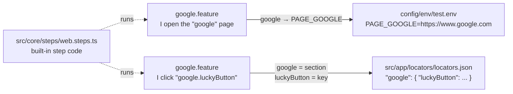
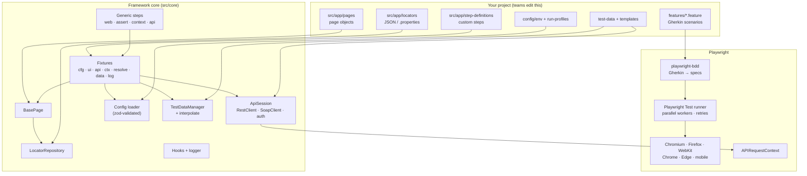
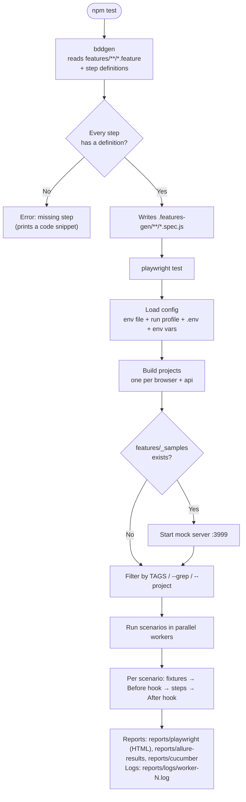
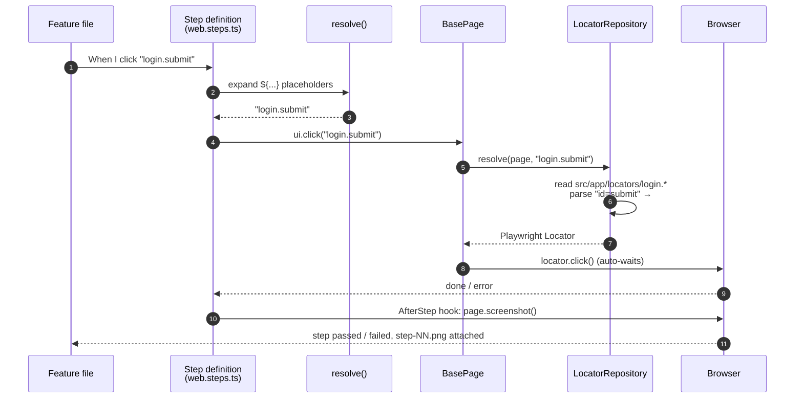
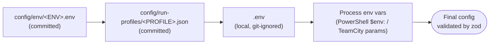
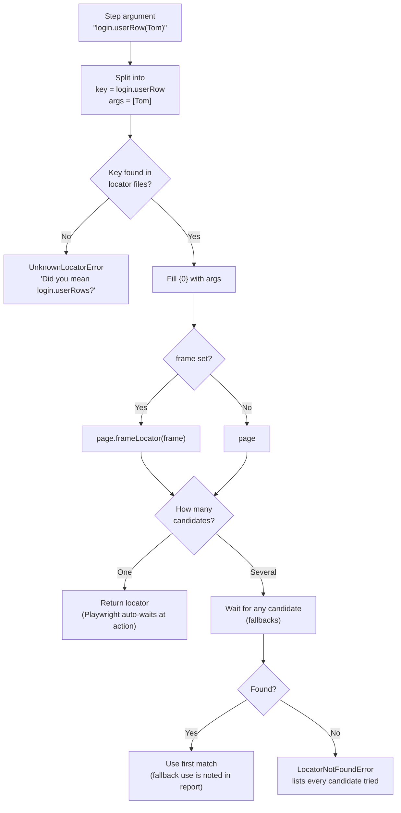
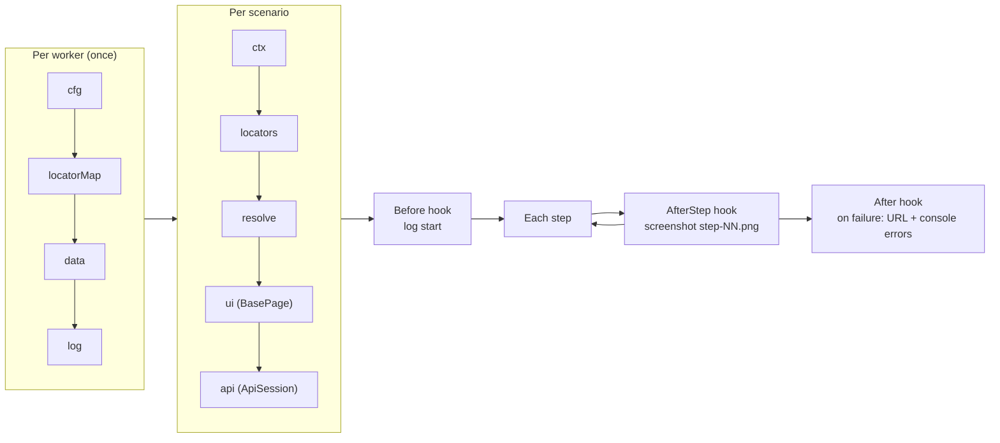
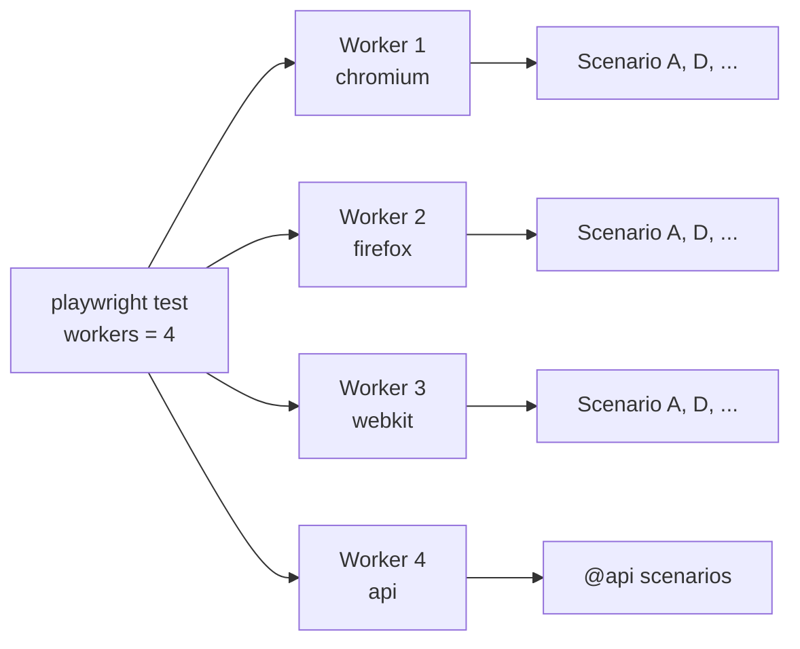

# Playwright + TypeScript + Cucumber BDD Framework

A blank, reusable test automation framework for **web and API (REST + SOAP)** testing, written in **Cucumber BDD** (Gherkin) format.

- Runs on Chromium, Chrome, Edge, Firefox, WebKit (Safari) and mobile emulation (Pixel, iPhone)
- Runs on Windows, macOS and Linux, in parallel
- 47 ready-made generic steps: many scenarios need no code at all
- Locators live in one file, `src/app/locators/locators.json` (a section per page, Selenium `By.*` values accepted), not in code
- Environment files, run profiles and secrets are kept separate
- Playwright HTML, Allure and Cucumber (HTML + JSON) reports from every run
- Built for TeamCity agents; BrowserStack and email summaries are planned (see [Roadmap](#roadmap))

You bring your own **features, steps, page objects, locators and test data**. The framework provides everything else.
It follows the same layout as the Selenium + Java + Cucumber framework it replaces, so the way of working stays familiar. See [docs/coming-from-selenium.md](docs/coming-from-selenium.md).

> The diagrams below use Mermaid. They render on GitHub, GitLab and Azure DevOps. In VS Code, install the
> **Markdown Preview Mermaid Support** extension and open the preview with `Ctrl+Shift+V`.

---

## Framework features

**Test design**
- Cucumber BDD: Gherkin `.feature` files run by Playwright Test through playwright-bdd
- 47 generic steps for web actions, assertions, waits, API, SOAP and scenario context (`npm run steps:list`)
- Custom steps, page objects and fixtures in `src/app`, picked up automatically
- Background, Scenario Outline and Examples, tags (`@wip`, `@skip`, `@slow`, `@timeout:N`, `@retries:N`, `@mode:serial`)

**Web automation**
- Browsers: Chromium, Chrome, Edge, Firefox, WebKit (Safari), Pixel and iPhone emulation
- `CommonUtils`: about 27 common actions (click, fill, type slowly, select, check, hover, drag and drop, upload, getText and more)
- `WaitUtils`: dynamic waits (page ready, visible, hidden, enabled, text, value, count, spinner, URL, title, network idle, response, custom condition); fixed sleeps are blocked by lint
- A page-ready check before every action: document fully loaded and no jQuery / ASP.NET AJAX pending, soft-capped so a stuck page can't hang the run
- New-tab switching, dialogs, iframes, file upload
- Console errors and page errors captured per scenario

**Locators**
- One file, `src/app/locators/locators.json`, with a section per page; referenced as `page.key`
- CSS, XPath, role, text, test id, label, placeholder and Selenium `By.*` syntax
- Fallback candidates (reported when a fallback is used), iframe locators, parameterised locators (`page.row(John)`)
- `npm run locators:check`: syntax errors, duplicate keys and unused locators

**API testing**
- REST client with bearer, basic, API key and OAuth2 client-credentials auth, plus retry
- SOAP client with XML templates and XPath checks
- JSON schema validation, response values stored for later steps
- Secrets masked in request and response attachments

**Test data and configuration**
- Per-environment config (`config/env/<env>.env`) and test data (`test-data/<env>/`)
- Secrets only in git-ignored `.env` or CI parameters, read with `${secret.X}`
- Placeholders in steps: `${data.x}`, `${env.X}`, `${secret.X}`, `${ctx.x}`, `${faker.mod.fn}`, `${today+2d:dd/MM/yyyy}`
- Run profiles (`local`, `headless`, `crossbrowser`, `ci`) for browsers, workers, retries, timeouts and screenshots, each overridable with environment variables
- Local, headless and remote Playwright server connections

**Execution and reporting**
- Parallel runs with configurable workers, retries, re-run of last failures
- Three reports, each switchable per run profile (`reports`) or with `REPORTS=...`:
  - Playwright HTML report with step screenshots, failure screenshots, video and trace
  - Allure report (Allure 3, no Java needed): features grouped per browser, Gherkin steps with screenshots, tags, environment details, history trends across runs
  - Cucumber HTML report and Cucumber JSON (for CI dashboards)
- Structured log files per worker (`reports/logs`)

**Tooling**
- Generators (`npm run generate`) for page object, locators section, steps, feature and API service
- Gherkin lint, ESLint, Prettier, TypeScript type-check, pre-commit hook, CODEOWNERS
- Unit tests for the framework core (`npm run test:unit`)
- Bundled samples with a mock server, removable with `npm run clean:samples`
- Playwright MCP config for AI-assisted locator and feature writing

Planned: email summary, TeamCity integration, BrowserStack (see [Roadmap](#roadmap)).

---

## Contents

1. [Quick start](#1-quick-start)
2. [Your first test in 5 minutes](#2-your-first-test-in-5-minutes)
3. [Project structure](#3-project-structure)
4. [Architecture](#4-architecture)
5. [Design flow diagrams](#5-design-flow-diagrams)
6. [Configuration](#6-configuration)
7. [Locators](#7-locators)
8. [Writing steps and page objects](#8-writing-steps-and-page-objects)
9. [Test data and placeholders](#9-test-data-and-placeholders)
10. [API testing](#10-api-testing)
11. [Running tests](#11-running-tests)
12. [Reports, logs and debugging](#12-reports-logs-and-debugging)
13. [Selenium to Playwright mapping](#13-selenium-to-playwright-mapping)
14. [Troubleshooting](#14-troubleshooting)
15. [Roadmap](#roadmap)
16. [Guides](#guides)

---

## 1. Quick start

Prerequisite: **Node.js 24** or later.

```powershell
npm ci                              # install dependencies
npx playwright install              # download browsers (one-off, large)
Copy-Item .env.example .env         # bash: cp .env.example .env
npm test                            # run the bundled samples
npm run report:open                 # open the HTML report
```

The samples in `features/_samples` run against a local mock application that starts automatically, so they need no internet access.

**Windows PowerShell only:** if `npx` fails with *"running scripts is disabled on this system"*, run this once:

```powershell
Set-ExecutionPolicy -Scope CurrentUser -ExecutionPolicy RemoteSigned
```

---

## 2. Your first test in 5 minutes

This example opens google.com and clicks a button. It needs **three files and no code**.

**Step 1: the page URL.** Add one line to `config/env/test.env`:

```properties
PAGE_GOOGLE=https://www.google.com
```

**Step 2: the locators.** Add a `google` section to `src/app/locators/locators.json`. The section name (`google`) is the page name:

```json
{
  "google": {
    "searchBox": "textarea[name='q']",
    "luckyButton": "role=button[name=\"I'm Feeling Lucky\"]"
  }
}
```

**Step 3: the feature.** Create `features/google/google.feature`:

```gherkin
@google
Feature: Google home page

  Scenario: Click the I'm Feeling Lucky button
    Given I open the "google" page
    When I click "google.luckyButton"
    Then the url should contain "doodles"
```

**Step 4: run it.**

```powershell
npx bddgen; npx playwright test --grep "@google" --project=chromium
```

How the names connect:



> Google blocks automated **searches** with a captcha page. Use it to practise clicks and navigation only.

---

## 3. Project structure

```
PlaywrightFramework/
│
├── features/                          ◄ YOUR Gherkin feature files
│   ├── <area>/<name>.feature
│   └── _samples/                      Bundled examples (removed by npm run clean:samples)
│       ├── web/                       smoke, login, table
│       └── api/                       users (REST), soap
│
├── src/
│   ├── app/                           ◄ YOUR code (picked up automatically)
│   │   ├── step-definitions/          Custom steps: *.steps.ts
│   │   ├── pages/                     Page objects: extend BasePage
│   │   ├── locators/                  locators.json: one section per page
│   │   ├── api/services/              REST/SOAP service wrappers
│   │   ├── hooks/                     Your Before/After hooks
│   │   ├── utils/                     Your helpers
│   │   └── fixtures.ts                Extend the test with your own fixtures
│   │
│   └── core/                          ◄ FRAMEWORK code (do not edit, see CODEOWNERS)
│       ├── config/                    loadConfig, schema (zod), projects (browsers)
│       ├── locators/                  parseLocator, loadLocatorFiles, LocatorRepository
│       ├── pages/                     BasePage: open, click, fill, select, upload, tabs, dialogs
│       ├── steps/                     44 generic steps: web, assert, context, api
│       ├── api/                       RestClient, SoapClient, ApiSession, auth, secret masking
│       ├── data/                      TestDataManager, placeholder interpolation
│       ├── fixtures/                  Playwright fixtures wiring everything together
│       ├── support/                   hooks, logger (pino), ScenarioContext
│       ├── errors.ts                  Framework error types
│       └── index.ts                   Public exports for your code
│
├── config/
│   ├── env/                           ◄ test.env, dev.env, uat.env: URLs and non-secret values
│   └── run-profiles/                  ◄ local, headless, crossbrowser, ci (replaces TestNG XML)
│
├── test-data/<env>/                   ◄ YOUR data: json, yaml, csv, xlsx
├── templates/                         ◄ API payloads
│   ├── json/                          REST request bodies
│   ├── soap/                          SOAP envelopes
│   └── schemas/                       JSON schemas for response validation
│
├── tests/
│   ├── mock-server/                   Local app used by the samples (port 3999)
│   └── unit/                          Unit tests of the framework itself
│
├── scripts/                           locators-check, clean-samples
├── generators/ + plopfile.cjs         npm run generate scaffolding templates
├── docs/                              Guides (see the end of this file)
│
├── playwright.config.ts               Main config: BDD, projects, reporters, mock server
├── playwright.unit.config.ts          Config for the framework's unit tests
├── .env.example → .env                Local secrets (.env is git-ignored)
├── tsconfig.json, eslint.config.mjs, .prettierrc, .gherkin-lintrc
├── CODEOWNERS                         src/core owned by the framework team
│
├── .features-gen/                     (generated) specs created by bddgen; do not edit
└── reports/                           (generated) HTML, Allure, Cucumber reports, logs
```

`◄` marks the folders your team works in. Everything under `src/core` is shared framework code.

---

## 4. Architecture

The framework is split into two layers. **Your code** (`src/app`, `features`, `config`, `test-data`, `templates`) sits on top of **framework code** (`src/core`), which sits on top of Playwright.



### Main components

| Component | File | What it does |
|---|---|---|
| Config loader | [src/core/config/loadConfig.ts](src/core/config/loadConfig.ts) | Merges env file, run profile, `.env` and environment variables; validates them with zod |
| Projects | [src/core/config/projects.ts](src/core/config/projects.ts) | Creates one Playwright project per browser, plus an `api` project |
| Locator repository | [src/core/locators/LocatorRepository.ts](src/core/locators/LocatorRepository.ts) | Turns `page.key` into a Playwright locator; supports fallbacks, frames and parameters |
| BasePage | [src/core/pages/BasePage.ts](src/core/pages/BasePage.ts) | Generic actions on locator keys: open, click, fill, select, check, upload, tabs, dialogs |
| Generic steps | [src/core/steps/](src/core/steps/) | 44 ready-made Gherkin steps |
| API session | [src/core/api/ApiSession.ts](src/core/api/ApiSession.ts) | REST and SOAP calls, auth, JSONPath, schema validation, masked attachments |
| Test data | [src/core/data/](src/core/data/) | Loads data files and expands `${...}` placeholders |
| Fixtures | [src/core/fixtures/index.ts](src/core/fixtures/index.ts) | Wires all of the above into each scenario |
| Hooks | [src/core/support/hooks.ts](src/core/support/hooks.ts) | Logs each scenario; screenshot after every step; URL and console errors on failure |

---

## 5. Design flow diagrams

### 5.1 End-to-end run flow

What happens when you type `npm test`:



### 5.2 One step, from Gherkin to browser



### 5.3 Configuration merge order

Later sources win. Secrets come **only** from `.env` and process environment variables, never from `config/env` files.



### 5.4 Locator resolution



### 5.5 Scenario lifecycle and fixtures



---

## 6. Configuration

### 6.1 Environment files: `config/env/<env>.env`

Non-secret values per environment. These files are committed, so **do not put passwords here**.

```properties
BASE_URL=https://test.myapp.com
API_DEFAULT_URL=https://test.myapp.com/api

PAGE_LOGIN=/login                         # relative to BASE_URL
PAGE_GOOGLE=https://www.google.com        # or a full URL

API_PAYMENTS_URL=https://payments.test.myapp.com
```

| Key pattern | Used by |
|---|---|
| `BASE_URL` | Required. Base for `/path` page URLs |
| `PAGE_<NAME>` | `Given I open the "<name>" page` (name upper-cased, spaces become `_`) |
| `API_DEFAULT_URL` | API steps when no API name is given |
| `API_<NAME>_URL` | `Given I use API "<name>"` |
| `API_<NAME>_TOKEN_URL`, `_CLIENT_ID`, ... | OAuth2 and other auth types (see [docs/api-testing.md](docs/api-testing.md)) |

Choose the environment with `ENV` (default `test`).

### 6.2 Secrets: `.env`

Copy `.env.example` to `.env` for local runs. On TeamCity, set them as **password parameters** exposed as environment variables. Use them in features as `${secret.NAME}`. They are masked in API attachments.

### 6.3 Run profiles: `config/run-profiles/*.json`

They replace TestNG XML files such as `localRun.xml`.

| Profile | Browsers | Headless | Workers | Retries |
|---|---|---|---|---|
| `local` (default) | chromium | No (visible) | auto | 0 |
| `headless` | chromium | Yes | auto | 0 |
| `crossbrowser` | chromium, firefox, webkit | Yes | 4 | 1 |
| `ci` | chromium | Yes | 4 | 1 |

All profile fields:

```jsonc
{
  "connection": "local",          // local | headless | remote | browserstack (phase 5)
  "env": "test",                  // which config/env file
  "browsers": ["chromium"],       // chromium, chrome, msedge, firefox, webkit, pixel, iphone
  "tags": "@smoke and not @wip",  // Cucumber tag expression
  "workers": 4,
  "retries": 1,
  "headless": true,
  "trace": "on-first-retry",      // off | on | retain-on-failure | on-first-retry
  "video": "retain-on-failure",   // off | on | retain-on-failure
  "screenshot": "only-on-failure",// off | on | only-on-failure   (end of test)
  "stepScreenshots": "on",        // on | only-on-failure | off    (after each step)
  "actionTimeoutMs": 15000,
  "remoteWsEndpoint": "ws://..."  // required when connection is "remote"
}
```

Any of these can be overridden for a single run with an environment variable: `PROFILE`, `ENV`, `BROWSERS`, `TAGS`, `WORKERS`, `RETRIES`, `HEADLESS`, `CONNECTION`, `STEP_SCREENSHOTS`.

---

## 7. Locators

All locators live in one file, `src/app/locators/locators.json`, with a section (header) per page. Keys are used as `section.key`, e.g. `login.username`.

```json
{
  "login": {
    "username": "id=username",
    "password": "#password",
    "submit": "role=button[name=\"Log in\"]",
    "saveButton": ["data-testid=save", "text=Save", "#legacy-save"],
    "editorBody": { "frame": "#editor-frame", "value": "body" }
  },
  "users": {
    "userRow": "xpath=//tr[td[text()='{0}']]",
    "heading": "By.xpath(\"//h2\")"
  }
}
```

Selenium `By.*` values work as-is. See [docs/locators.md](docs/locators.md) for migrating whole `.properties` files.

| Format | Example |
|---|---|
| CSS | `#id`, `.class`, `css=div > a` |
| XPath | `xpath=//a`, `//a` |
| Id / name | `id=username`, `[name="q"]` |
| Text | `text=Save` |
| Role | `role=button[name="Save"]` |
| Test id / label / placeholder | `testid=save`, `label=Email`, `placeholder=Search` |
| Selenium | `By.id`, `By.name`, `By.cssSelector`, `By.xpath`, `By.linkText`, `By.partialLinkText`, `By.className`, `By.tagName` |
| Parameters | `{0}`, `{1}` filled from `page.key(Tom, 2)` |
| Fallbacks | An array: each candidate is tried in order |
| Frames | `{ "frame": "#iframe", "value": "..." }` or `{ "frame": "...", "candidates": [...] }` |

Check them with `npm run locators:check`. Full guide: [docs/locators.md](docs/locators.md).

---

## 8. Writing steps and page objects

### 8.1 Use the built-in steps first

```gherkin
Given I open the "login" page
When I enter "${data.users.admin.name}" into "login.username"
And I enter "${secret.ADMIN_PASSWORD}" into "login.password"
And I click "login.submit"
Then "dashboard.welcome" should contain text "Welcome"
```

List every step with `npm run steps:list` or see [docs/step-catalogue.md](docs/step-catalogue.md).

### 8.2 Custom steps: `src/app/step-definitions/*.steps.ts`

```ts
import { Given, When, Then } from '../fixtures';

When('I log in as {string}', async ({ ui, data, resolve }, user: string) => {
  await ui.fill('login.username', data.get(`users.${user}.name`));
  await ui.fill('login.password', resolve('${secret.ADMIN_PASSWORD}'));
  await ui.click('login.submit');
});
```

### 8.3 Common actions and dynamic waits: `common` and `wait`

Step definitions and page objects get two helpers. Both accept a locator key (`'page.key'`) or a Playwright `Locator`.

- **`common`** ([CommonUtils.ts](src/core/utils/CommonUtils.ts)): `click`, `doubleClick`, `rightClick`, `hover`, `jsClick`, `dragAndDrop`, `scrollIntoView`, `fill`, `typeSlowly`, `clear`, `press`, `pressKey`, `focus`, `upload`, `select`, `selectByIndex`, `check`, `uncheck`, `getText`, `getAllTexts`, `getValue`, `getAttribute`, `getSelectedOption`, `isVisible`, `isEnabled`, `isChecked`, `count`.
- **`wait`** ([WaitUtils.ts](src/core/utils/WaitUtils.ts)): `waitForPageReady`, `waitForVisible`, `waitForHidden`, `waitForAttached`, `waitForDetached`, `waitForEnabled`, `waitForText`, `waitForValue`, `waitForAttribute`, `waitForCount`, `waitForSpinnerToDisappear`, `waitForUrl`, `waitForTitle`, `waitForNetworkIdle`, `waitForResponseAfter`, `waitUntil`.

**Every action waits for the page to be ready first**: `document.readyState` is `complete` and no jQuery or ASP.NET AJAX request is in flight. The wait is capped by `pageReadyTimeoutMs` (default 10s). If a page never settles, for example because a third-party widget blocks the `load` event, the action goes ahead, the test gets a `page-not-ready` annotation, and that page isn't waited on again. Playwright still checks that the element is visible, enabled and stable before acting. The built-in steps (`I click ...`, `I enter ...`) use the same helpers.

```ts
import { Given, When } from '@app/fixtures';

When('I search the quote for {string}', async ({ common, wait, resolve }, code: string) => {
  await common.click('netwealthQuote.menuLink');
  await wait.waitForUrl('QuoteSearch.aspx');
  await common.fill('netwealthQuote.searchBox', resolve(code));
  await common.click('netwealthQuote.displayBtn');
  await wait.waitForVisible('netwealthQuote.securityName');
});
```

Fixed sleeps (`waitForTimeout`, `setTimeout` promises) are blocked by lint; use a `wait` method instead.

### 8.4 Page objects: `src/app/pages/*.ts`

```ts
import { BasePage } from '../../core/index';

export class LoginPage extends BasePage {
  async loginAs(name: string, password: string) {
    await this.fill('login.username', name);
    await this.fill('login.password', password);
    await this.click('login.submit');
    await this.wait.waitForUrl('/home'); // this.common and this.wait are available in page objects too
  }
}
```

### 8.5 Scaffold everything

```powershell
npm run generate      # choose page, locators, steps, feature or api-service
```

---

## 9. Test data and placeholders

Data files go in `test-data/<env>/` (json, yaml, csv, xlsx). Any step argument can contain placeholders:

| Placeholder | Value |
|---|---|
| `${data.users.admin.name}` | From `test-data/<env>/users.json` |
| `${env.BASE_URL}` | From the config |
| `${secret.ADMIN_PASSWORD}` | From `.env` or CI parameters (masked) |
| `${ctx.orderId}` | A value saved earlier in the same scenario |
| `${faker.person.firstName}` | Random data (Faker) |
| `${today}`, `${today+5d:dd/MM/yyyy}` | Dates |

Guide: [docs/test-data.md](docs/test-data.md).

---

## 10. API testing

Tag API scenarios with `@api`. They run in the `api` project, without a browser.

```gherkin
@api
Scenario: Create a user
  Given I use API "sample" with auth "oauth2"
  When I send POST to "/users" with body "createUser.json"
  Then response status should be 201
  And response should match schema "user.schema.json"
  And I store response path "$.id" as "userId"
  When I send GET to "/users/${ctx.userId}"
  Then response path "$.name" should not be empty
```

Supports bearer, basic, API key and OAuth2 auth, JSONPath checks, JSON schema validation and SOAP envelopes. Guide: [docs/api-testing.md](docs/api-testing.md).

---

## 11. Running tests

| Command | What it does |
|---|---|
| `npm test` | Generate specs and run everything in the active profile |
| `npm run test:web` | Web scenarios only (not `@api`) |
| `npm run test:api` | API scenarios only (`@api`) |
| `npm run test:failed` | Re-run only the scenarios that failed last time |
| `npm run test:debug` | Visible browser with the Playwright Inspector |
| `npx bddgen; npx playwright test --grep "@google"` | One tag only |
| `npm run report:open` | Open the HTML report |
| `npm run codegen -- <url>` | Record clicks to find locators |
| `npm run steps:list` | Print every available step |
| `npm run locators:check` | Check locator syntax, duplicates and unused keys |
| `npm run generate` | Scaffold a page, locators, steps, feature or API service |
| `npm run lint` / `npm run lint:gherkin` | Lint TypeScript / feature files |
| `npm run typecheck` | TypeScript type check |
| `npm run test:unit` | The framework's own unit tests |
| `npm run clean:samples` | Remove the bundled samples |

### Choosing profile, environment, browsers and tags

| | PowerShell | bash |
|---|---|---|
| Profile | `$env:PROFILE='crossbrowser'; npm test` | `PROFILE=crossbrowser npm test` |
| Environment | `$env:ENV='uat'; npm test` | `ENV=uat npm test` |
| Browsers | `$env:BROWSERS='chrome,firefox'; npm test` | `BROWSERS=chrome,firefox npm test` |
| Tags | `$env:TAGS='@smoke and not @wip'; npm test` | `TAGS='@smoke and not @wip' npm test` |
| One browser | `npm test -- --project=firefox` | same |
| Workers | `npm test -- --workers=6` | same |

PowerShell keeps `$env:` values until the window is closed. Clear one with `Remove-Item Env:PROFILE`.

### Special tags

| Tag | Effect |
|---|---|
| `@api` | Runs in the API project, no browser |
| `@wip` | Work in progress (exclude with `not @wip`) |
| `@skip` / `@fixme` | Skip the scenario |
| `@slow` | Triple the timeout |
| `@timeout:60000` | Custom timeout in ms |
| `@retries:2` | Custom retry count |
| `@mode:serial` | Run the feature's scenarios one after another |

### Parallel execution



Each scenario gets its own browser context, so scenarios never share cookies or state.

---

## 12. Reports, logs and debugging

| Output | Location |
|---|---|
| Playwright HTML report (steps, screenshots, video, trace) | `reports/playwright/` → `npm run report:open` |
| Allure report | Built automatically after every run: `reports/allure-report/index.html` (one file; double-click to open, or `npm run report:allure`) |
| Cucumber HTML report | `reports/cucumber/report.html` → `npm run report:cucumber` |
| Cucumber JSON (for CI tools) | `reports/cucumber/report.json` (text attachments only, no images) |
| Screenshot after every UI step | Attached as `step-01 <step text>.png`, `step-02 ...`; a failed step is marked `FAILED` |
| Logs per worker | `reports/logs/worker-<n>.log` |
| On failure | Screenshot, video, page URL, console errors; trace on first retry |
| API calls | Request and response attached to the report, secrets masked as `***` |

### Choosing reports

All three reports are on by default. Turn them on or off in a run profile, or for one run:

```jsonc
// config/run-profiles/ci.json
{ "connection": "headless", "browsers": ["chromium"], "reports": ["allure", "cucumber"] }
```

```powershell
$env:REPORTS='allure'; npm test        # only Allure for this run
```

The console `list` output is always on. The reporters are built in [src/core/config/reporters.ts](src/core/config/reporters.ts).

**Allure** uses Allure 3 (the `allure` npm package), so no Java is needed. Settings are in [allurerc.mjs](allurerc.mjs).
Tests are grouped by browser, then Feature. Each Gherkin step shows its screenshot; tags and run details (environment, profile, browsers, base URL) appear on every test.
Each run clears `reports/allure-results/` first and rebuilds `reports/allure-report/index.html` at the end; the console prints its path. `reports/allure-history.jsonl` keeps the last 20 runs, so the report shows trends, new failures and flaky tests.
On CI, keep that file between builds (for example as a TeamCity artifact dependency) to keep the history.

```powershell
npm run report:allure            # open the last Allure report in the browser
npm run report:allure:generate   # rebuild it from reports/allure-results (normally not needed)
```

**Cucumber** reports come from playwright-bdd's Cucumber reporter: `report.html` is a single self-contained file with steps and screenshots; `report.json` is the standard Cucumber JSON that CI plugins read.

### Step screenshots

By default the framework attaches a screenshot of the active tab **after every UI step** (API scenarios are skipped).
Open the report, click a scenario and look under **Attachments**.

| Setting | Result |
|---|---|
| `"stepScreenshots": "on"` (default) | A screenshot after every step |
| `"stepScreenshots": "only-on-failure"` | Only the step that failed |
| `"stepScreenshots": "off"` | None (fastest, e.g. for large CI runs) |

Set it in a run profile, or for one run: `$env:STEP_SCREENSHOTS='off'; npm test`.
The code is the `AfterStep` hook in [src/core/support/hooks.ts](src/core/support/hooks.ts).

Debugging:

```powershell
npx playwright test --grep "@google" --project=chromium --debug   # step through with the Inspector
npx playwright show-trace test-results/<folder>/trace.zip         # replay a trace
```

---

## 13. Selenium to Playwright mapping

| Selenium framework | This framework |
|---|---|
| `src/test/resources/features` | `features/` |
| Step definition classes | `src/app/step-definitions/*.steps.ts` |
| Page classes | `src/app/pages/*.ts` (extend `BasePage`) |
| Object repository / `By.*` | `src/app/locators/*.properties` or `*.locators.json` |
| `config.properties` per environment | `config/env/<env>.env` |
| TestNG XML (`localRun.xml`) | `config/run-profiles/*.json` |
| `@Before` / `@After` hooks | `src/app/hooks/*.ts` |
| `WebDriverWait` / explicit waits | Not needed: Playwright waits automatically |
| `Thread.sleep` | Not allowed (blocked by lint rule) |
| `driver.switchTo().frame()` | `"frame"` in the locator file |
| Extent report | Playwright HTML now; Allure + Cucumber in phase 3 |

More: [docs/coming-from-selenium.md](docs/coming-from-selenium.md).

---

## 14. Troubleshooting

| Problem | Cause and fix |
|---|---|
| `npx.ps1 cannot be loaded because running scripts is disabled` | PowerShell execution policy. Run `Set-ExecutionPolicy -Scope CurrentUser -ExecutionPolicy RemoteSigned` once, or use `npx.cmd` |
| `Error: No tests found` | The file isn't saved, the tag doesn't match, or a leftover `$env:TAGS` / `$env:BROWSERS` / `$env:PROFILE` value is filtering it out. Clear them with `Remove-Item Env:TAGS` or open a new terminal |
| `No URL for page 'x'. Add PAGE_X=...` | Add `PAGE_X=<url>` to `config/env/<env>.env` |
| `Unknown locator 'page.key'` | Add the key under the `page` section of `src/app/locators/locators.json`; the error suggests close matches |
| `Missing step definition` | The step text doesn't match any step. Run `npm run steps:list`, or write a custom step |
| `Missing secret X` | Add `X=...` to `.env`, or set it as a CI parameter |
| Element not found or timeout | Check the locator with `npm run codegen -- <url>` or `--debug`; look for pop-ups such as cookie banners |
| Google shows a captcha page | Google blocks automated searches; test your own application instead |

---

## AI assistance (Playwright MCP)

The repo includes [.mcp.json](.mcp.json), which gives Claude Code the [Playwright MCP](https://github.com/microsoft/playwright-mcp) server so it can drive a real browser (Edge, fresh profile each time, output in `reports/mcp/`).

1. Start `claude` in the repo root and approve the `playwright` server when asked (or run `/mcp`).
2. Ask, for example: *"Open https://test.myapp.com/login and add a `login` section to `src/app/locators/locators.json` with locators for the form"*, or *"Write a feature for the login flow using only steps from docs/step-catalogue.md"*.

---

## Roadmap

| Phase | Content | Status |
|---|---|---|
| 1–2 | Core framework: config, locators, BasePage, CommonUtils/WaitUtils, 47 steps, REST/SOAP, data, samples, tooling | Done |
| 3 | Allure and Cucumber reports | Done |
| 3b | Email summary | Planned |
| 4 | TeamCity: build configuration, parameters, artifacts, test reporting | Planned |
| 5 | BrowserStack: `connection: "browserstack"`, OS/browser matrix | Planned |
| 6 | AI and MCP: Playwright MCP, AI failure triage, locator self-healing suggestions, feature generation | Planned |
| 7 | Extras: visual comparison, accessibility checks, performance timings | Planned |

The full design is in [docs/superpowers/specs/2026-10-29-playwright-bdd-framework-design.md](docs/superpowers/specs/2026-10-29-playwright-bdd-framework-design.md).

---

## Guides

- [Writing features](docs/writing-features.md): tags, custom steps, page objects, fixtures
- [Step catalogue](docs/step-catalogue.md): every built-in step with an example
- [Locators](docs/locators.md): formats, Selenium `By.*`, fallbacks, frames, parameters
- [Test data and placeholders](docs/test-data.md)
- [API testing](docs/api-testing.md): REST, auth, SOAP, schemas
- [Run profiles and configuration](docs/run-profiles.md)
- [Coming from the Selenium framework](docs/coming-from-selenium.md)
